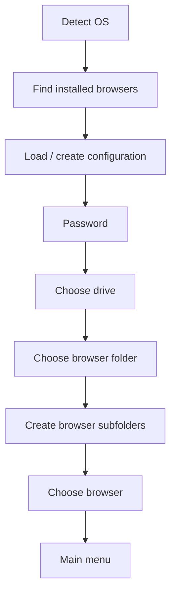

<div align="center">

# ⚡ FlashBrowser

**A console manager for a "portable" browser: your own browser profile on a flash drive, password protection, and one-key launch profiles.**


</div>

---

## 📖 Table of Contents

1. [What it is and why](#-what-it-is-and-why)
2. [Key concepts](#-key-concepts)
3. [Requirements and launch](#-requirements-and-launch)
4. [Keyboard controls](#-keyboard-controls)
5. [First launch step by step](#-first-launch-step-by-step)
6. [Main menu](#-main-menu)
7. [Working with profiles](#-working-with-profiles)
8. [Typical scenarios](#-typical-scenarios)
9. [Where data is stored](#-where-data-is-stored)
10. [FAQ and troubleshooting](#-faq-and-troubleshooting)
11. [Known quirks](#-known-quirks)

---

## 🎯 What it is and why

FlashBrowser is a terminal application (no windows, no mouse) that:

- 🚀 **launches a browser** (Firefox, Chrome or Chromium) with a **separate profile** stored in a folder of your choice — for example, on a flash drive;
- 🔐 **protects access with a password** — the app won't open without it;
- 🗂 **stores launch profiles** — sets of links and programs that open with a single command ("Work", "Study", "Evening", etc.);
- 🧹 **manages open tabs and cookies** — close everything, or clear cookies for one site or for all of them;
- 🧯 **force-kills browser processes** if the browser freezes.

Because the browser data (logins, cookies, extensions) lives in the folder you picked rather than in the system's main profile, you can carry your browser with you and leave no traces on someone else's computer.

---

## 🧩 Key concepts

| Concept | What it is |
|---|---|
| **Browser folder** | A folder (default name `browser_flash`) where the app creates subfolders with browser data: `firefox`, `chrome`, `chromium`. |
| **Launch profile** | A named set: a **list of links** + a **list of programs**. Opened as a whole with `Open profile`. |
| **App profile** | A program that belongs to a launch profile. It has **its own executable path for each OS** (Windows / Linux / macOS). |
| **Active browser** | The browser you're currently working with (when several are found on the computer). |

```
Launch profile "Work"
 ├── 🔗 Links:   https://mail.example.com, https://tracker.example.com
 └── 🖥 Apps:    Slack   → windows: C:\...\slack.exe | linux: /usr/bin/slack
                 VS Code → windows: C:\...\Code.exe  | linux: /usr/bin/code
```

---

## 🛠 Requirements and launch

**You need:**

- **.NET 8 SDK or newer** (the code uses C# 12 features);
- an installed **Firefox**, **Chrome** or **Chromium** (Chromium is supported on Linux and macOS only);
- a terminal with ANSI color support (on Windows the app enables it automatically) and a **sufficiently wide window**.

**Launch** (from the project folder):

```bash
dotnet run
```

> 💡 To conveniently pick a folder on a flash drive, plug the drive in **before** starting the app.

---

## ⌨️ Keyboard controls

Everything is controlled from the keyboard.

| Key | Action |
|---|---|
| `↑` / `↓` | Move through the menu |
| `W` / `S` | Same (up / down) |
| `PageUp` / `PageDown` | Same (up / down) |
| `Enter` | Select an item / confirm input |
| `Esc` or `Backspace` | **Back** from a menu (in text fields: `Esc` cancels, `Backspace` deletes a character) |
| `Y` / `N` | "Yes" / "No" for confirmation prompts |
| `Ctrl+C` | Gracefully interrupt the app |

This is what the interface elements look like:

```text
<< Select action >>              ← menu: the selected item has an arrow
-> Open profile
   Edit profiles
   Select browser for work

[Type a profile name] >          ← text input field

[< Close all pages? >] y/n       ← confirmation
```

> ⚠️ **On the startup setup steps (choosing a drive, folder, browser) use `Enter`.** `Esc` is not designed to cancel there.

---

## 🚦 First launch step by step

On startup the app goes through several preparation stages. If a stage fails, you'll see a message about it.



### 1️⃣ OS detection and browser search

The app detects your OS (Windows / Linux / macOS) and looks for browsers in the standard programs folder:

| OS | Where it looks |
|---|---|
| Windows | `C:\Program Files\` |
| Linux | `/usr/bin/` |
| macOS | `/Applications/` |

It looks for files named `firefox`, `chrome`, `chromium`. The messages tell you for which browser a path was found.

### 2️⃣ Configuration

A `data` folder with a `local.json` file is created next to the app. It stores the password (as a hash), profiles, and the folder history.

### 3️⃣ 🔐 Password

**Very first launch** — the app greets you and asks you to create a password:

```text
Hello a new user, it's FlashBrowser app
[Type a new password] >
[Repeat a new password] >
```

- Password length: **9 to 20 characters**.
- If the two entries don't match, the prompt is shown again.
- After creating the password, you don't have to enter it again during that same run.

**Subsequent launches** — you must enter the password (characters are hidden as `*`):

```text
Hello user, it's FlashBrowser app
[Type a password] > ********
```

You get **3 attempts** (`Wrong password, attempts 2/3`). After the third failure the app exits.

### 4️⃣ Choosing a drive

```text
<< Select drive device >>
-> E:\
   C:\
```

**Removable drives (flash drives)** are shown. If there are none, all ready drives are shown.

### 5️⃣ Choosing the browser folder

```text
<< Search variant >>
-> Search through selected drive <E:\>
   Search through selected drive <E:\> with custom name
   Auto search from application folder
   Search from custom path
   D:\old\browser_flash          ← folders from history appear here
```

| Option | What it does |
|---|---|
| **Search through selected drive** | Looks for a `browser_flash` folder in the root of the selected drive. If it doesn't exist, you'll be told it wasn't found (create it manually and try again). |
| **… with custom name** | Same, but asks whether to use the name `browser_flash`. Answer `n` to type your own name (no leading or trailing `/` or `\`). |
| **Auto search from application folder** | Uses (or **creates**, if missing) a `browser_flash` folder next to the app. The simplest "just get started" option. |
| **Search from custom path** | You type the full path to the folder. |
| **History items** | The most recently used folders (up to 20). If a folder no longer exists, the app offers to remove it from the history. |

The chosen folder is remembered in the history.

### 6️⃣ Preparation and browser selection

Subfolders `firefox` / `chrome` / `chromium` are created automatically in the browser folder — one for each browser that was found. If there are several browsers, you'll be asked to pick the active one; if there is only one, it's selected automatically.

After that the **main menu** opens 🎉

---

## 🏠 Main menu

```text
<< Select action >>
-> Open profile
   Edit profiles
   Select browser for work
   Launch selected browser <Chrome>
   Kill all browser <Chrome> process
```

> 🔎 **The menu is dynamic** — only items that make sense right now are shown.

| Item | Visible when | What it does |
|---|---|---|
| **Launch selected browser** | Browser is not running | Launches the selected browser with your profile from the browser folder. |
| **Open profile** | Browser is running | Opens the selected launch profile: all links in tabs and all programs. |
| **Edit profiles** | Always | Create, change, delete and view profiles. |
| **Select browser for work** | Always | Switch the active browser. |
| **Close all pages [N]** | There are open tabs | Closes all tabs opened through the app. `N` is their count. |
| **Clear cookies** | There are open tabs | Clears cookies for a chosen site or for all sites. |
| **Deactivate browser <…> process PID** | Browser is running | Closes tabs and the browser, and terminates its process. |
| **Kill all browser <…> process** | Browser is **not** running via the app | Forcibly terminates processes named after the browser (for when it hangs). |

### 🚪 Exiting

Press `Esc` in the main menu. The app asks you to confirm the exit by pressing it repeatedly:

```text
If you want exit, press ESC <2/3> once
If you want exit, press ESC <1/3> once
```

The app exits after **three** consecutive `Esc` presses. Choosing any action resets the counter.

> 💡 **Before exiting**, it's best to run `Deactivate browser` so the browser closes cleanly.

### 🚀 Launch selected browser

Starts the browser in normal (non-headless) mode with a separate profile from `<browser folder>/<browser name>`. Everything you do in this browser — logins, cookies, extensions — stays in that folder. The log shows a message like `Launch browser <Chrome>, use '<path to exe>'`.

### 📂 Open profile

1. You pick a launch profile from the list.
2. The app opens **each link** in a new tab.
3. Then it launches **each program** of the profile (maximized) using the path set for your OS.
4. A result is printed for every step: `Open link, '…'` / `Failed open link, '…'`, `Open application, '…'` / `Failed open application, '…'`.

If no path is set for your OS, you'll see `execute path for '…' operating system undefined`; everything else keeps working.

If the browser isn't running, the app tells you: `Browser not run, launch any browser and retry`.

### 🧹 Clear cookies

```text
<< Select a site >>
-> github.com
   mail.example.com
   (danger) all
```

- The list contains the **sites of open tabs**; the last item, `(danger) all`, means all tabs at once.
- After choosing, you must confirm (`y`/`n`).
- The app prints the cookies it found (domain, name, expiry) and deletes them.
- Afterwards you return to the list, so you can clear another site. `Esc` exits.

> Works with tabs **opened through the app**.

### 🗑 Deactivate browser

Closes all tabs, closes the browser and terminates its process. After that, `Launch selected browser` reappears in the menu.

### ☠️ Kill all browser … process

Terminates **all processes whose name starts with the browser's name** (`firefox`, `chrome`, `chromium`).

> ⚠️ **Warning:** processes of your regular browser that are unrelated to the app will be terminated too. No confirmation is requested. Use it only if the browser is frozen and `Deactivate` doesn't help.

---

## 🗂 Working with profiles

Open **Edit profiles** — this menu appears:

```text
<< Select action for profile >>
-> Change profile
   Delete profile
   New profile
   Select profile
   View info
```

> 💾 Profile changes are **saved automatically** after each action in this menu.

For `Change profile` and `Delete profile` you first need to select a profile (`Select profile`) — the app shows the list itself.

### ➕ New profile

Enter a profile name (**at least 4 characters**). The profile is created empty — fill it in via `Change profile`.

### ✏️ Change profile

```text
<< Select change profile method >>
-> Change name
   Edit applications profile
   Change web links profile
```

#### Change name
Enter the new name (at least 4 characters).

#### Change web links profile — links

```text
<< Select a link for change >>
-> https://mail.example.com
   https://tracker.example.com
   New link +
```

- **`New link +`** — add a link. A full address with protocol is required, e.g. `https://example.com`. A new link is placed **at the top of the list** (and opens first).
- **Selecting an existing link** — offers to **delete** it (`y`/`n`). The prompt shows the beginning of the link.

#### Edit applications profile — programs

```text
<< Select action for app profile >>
-> Change application paths
   New profile
   Change name
   Delete profile
   Select profile
```

1. `New profile` — create a program (enter a name, e.g. `Slack`).
2. `Change application paths` — pick a program, then an OS:

```text
<< Select os path >>
-> [current] windows: C:\Apps\slack.exe
   linux:
   macos:
```

   A path **can only be set for the current OS** (marked `[current]`). For other OSes the app says it can't be done right now — set them by running the app on the corresponding system. The path must **exist**, otherwise the input field won't accept it.

3. `Change name` / `Delete profile` — rename or delete a program.

### 🗑 Delete profile

Select a profile and confirm deletion (`y`). To cancel, press `Esc`.

### 👀 View info

Prints all profiles with their links and programs:

```text
List launch profiles
<< [Work] >>
	https://mail.example.com
	Slack [3]
		windows: C:\Apps\slack.exe
		linux: undefined
		macos: undefined
```

---

## 🧭 Typical scenarios

### Scenario 1. "First launch and first profile"

1. `dotnet run` → create a password.
2. Choose a drive → `Auto search from application folder`.
3. In the menu: **Edit profiles** → **New profile** → name it `Work`.
4. **Change profile** → pick `Work` → **Change web links profile** → **New link +** → add links. `Esc` to go back.
5. (optional) **Edit applications profile** → **New profile** → **Change application paths** — add programs.
6. `Esc` back to the main menu → **Launch selected browser**.
7. **Open profile** → pick `Work` — everything opens by itself.

### Scenario 2. "Working from a flash drive"

1. Plug in the drive and create a `browser_flash` folder in its root.
2. On startup choose the drive → `Search through selected drive`.
3. The browser keeps its data on the drive; next time the path will be available in the history.

### Scenario 3. "Cleaning up when leaving"

1. **Clear cookies** → `(danger) all` → `y`.
2. **Close all pages** → `y`.
3. **Deactivate browser** → exit with triple `Esc`.

### Scenario 4. "The browser froze"

1. If you launched it through the app — **Deactivate browser**.
2. If that doesn't help, or the browser wasn't started by the app — **Kill all browser … process** (⚠️ terminates all processes of this browser).

---

## 💾 Where data is stored

| What | Where |
|---|---|
| Settings, password (SHA-256), folder history, launch profiles | `data/local.json` next to the app |
| Browser data (cookies, logins, extensions) | `<browser folder>/<firefox \| chrome \| chromium>/` |

`local.json` is a plain JSON file. The password is stored as a hash, but **profiles and history are stored in plain text**.

---

## ❓ FAQ and troubleshooting

<details>
<summary><b>I forgot my password — what now?</b></summary>

The password can't be recovered (only its hash is stored). The way out is to delete `data/local.json`: on the next launch the app will ask you to create a new password. ⚠️ **All launch profiles and the folder history** will be lost along with the file, so make a copy first.
</details>

<details>
<summary><b>The app keeps repeating "Search browser applications" and doesn't proceed</b></summary>

This means no browser was found automatically: the search covers **only the top level of** the programs folder (`C:\Program Files\`, `/usr/bin/`, `/Applications/`), and the file must be named exactly `firefox`, `chrome` or `chromium`. Press `Ctrl+C` and add a link/file with the right name to that folder (for example, a symbolic link `chrome` pointing to `google-chrome` on Linux).
</details>

<details>
<summary><b>There's no "Open profile" item in the menu</b></summary>

It appears only after the browser is launched — choose `Launch selected browser`.
</details>

<details>
<summary><b>"Clear cookies" and "Close all pages" are missing</b></summary>

They are visible only if at least one tab has been opened through the app.
</details>

<details>
<summary><b>I don't see "Chromium" in the browser list on Windows</b></summary>

Chromium is supported on Linux and macOS only.
</details>

<details>
<summary><b>I can't add a link or path — the field "doesn't accept" my input</b></summary>

A link must be **complete** (`https://…`), and a program path must **actually exist**. With invalid input the field simply keeps waiting for a valid value; `Esc` cancels.
</details>

<details>
<summary><b>The interface looks broken or shifted</b></summary>

Make the terminal window wider and use a terminal with ANSI color support.
</details>

---

## 🐞 Known quirks

Current behavior details that are good to know:

| Where | What happens | Workaround |
|---|---|---|
| Startup menus (drive, folder, browser) | `Esc` doesn't cancel the choice and may cause an error | Choose an item with `Enter` |
| `Close all pages` | Any answer (including `n`) closes the tabs; cancelling works only via `Esc` | If you don't want to close them, press `Esc` |
| `Kill all browser … process` | A successful process kill may be handled as an error, and success/error messages are swapped | Verify the result in the task manager |
| Deleting a link in a profile | For links shorter than 20 characters the delete prompt may cause an error | Use links longer than 20 characters or edit `local.json` |
| Input length for names and passwords | The effective minimum is 1 character more than declared (password — 9, profile name — 4) | Keep it in mind when typing |

---

<div align="center">

Made with ⚡ — enjoy!

</div>
